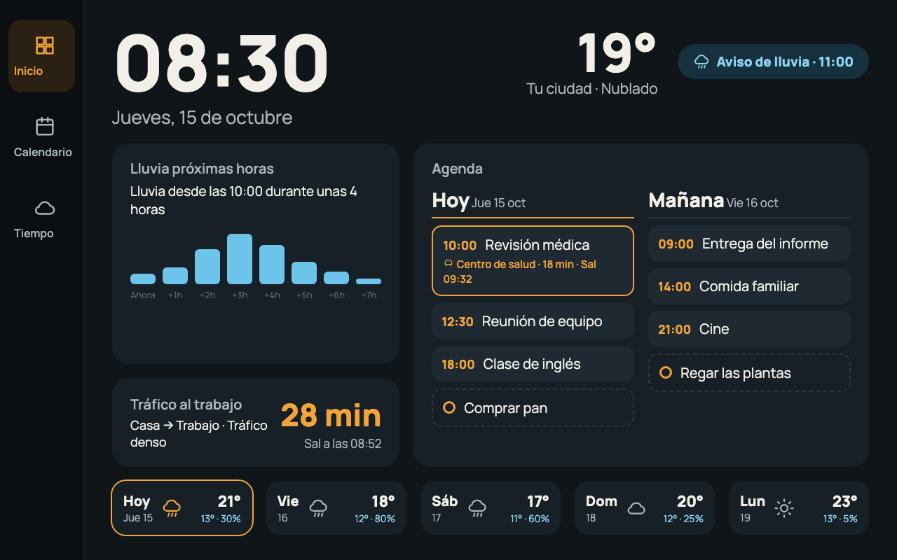
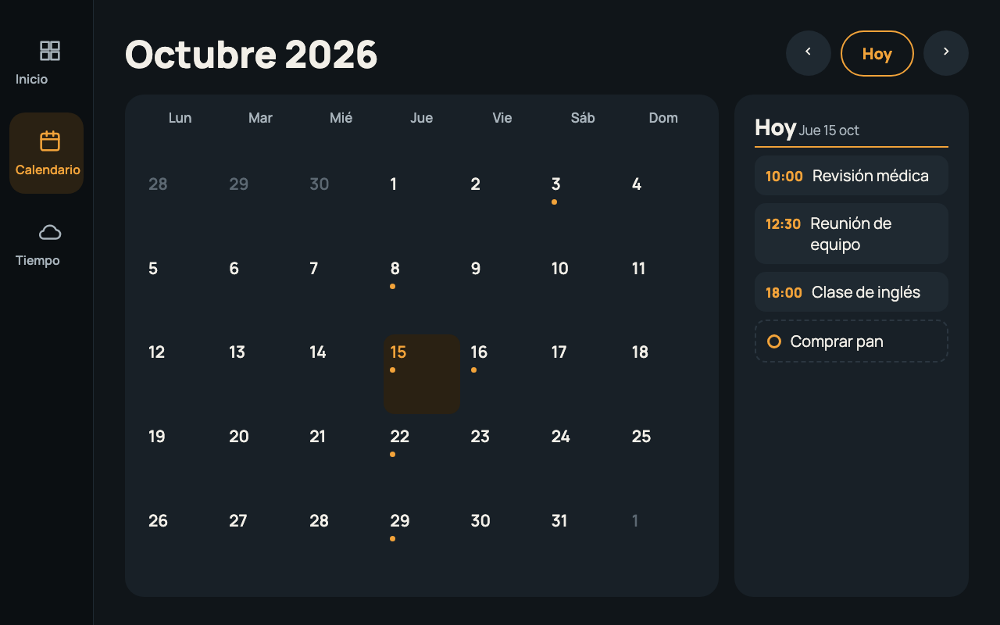
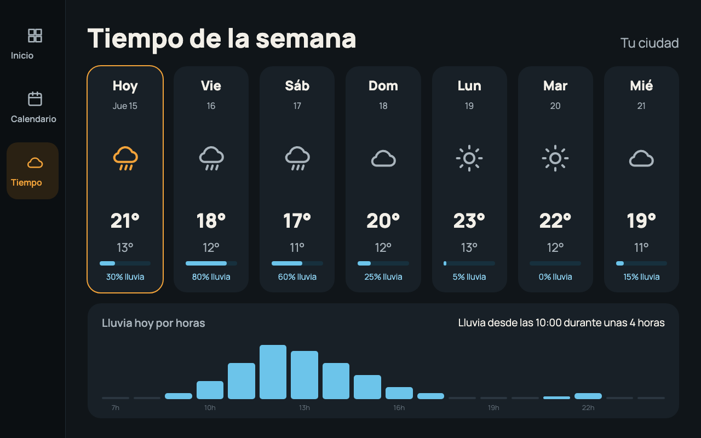
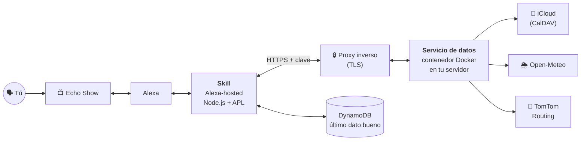
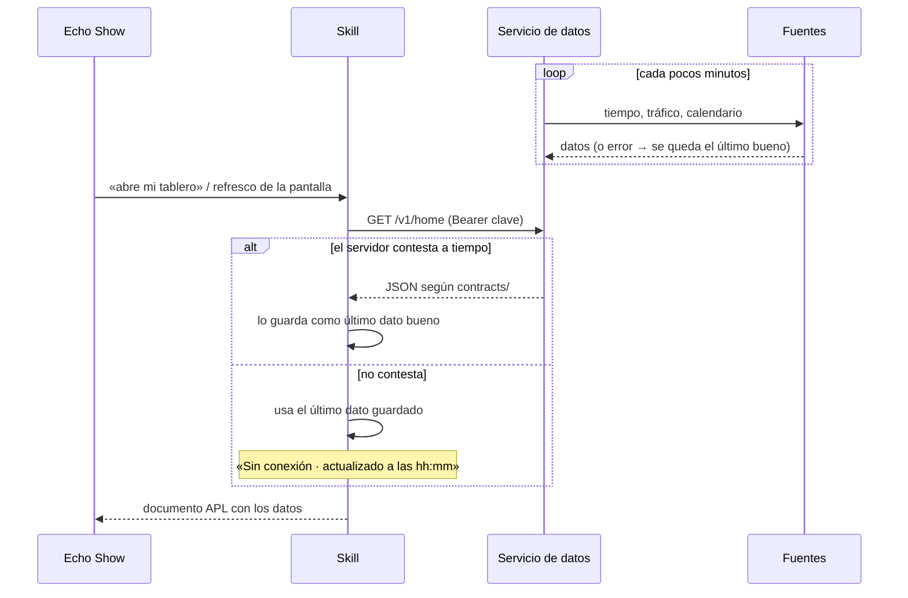
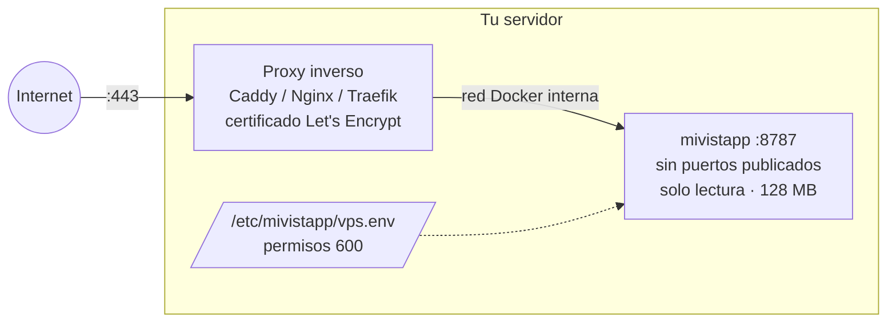
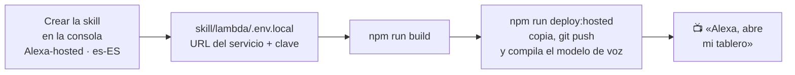

# Mi VistApp

**Un panel siempre visible para el Echo Show:** la hora, el tiempo, la lluvia de las próximas horas, el tráfico hasta el trabajo y tu agenda de hoy y mañana, en una sola pantalla que se lee desde el otro lado de la habitación.

Es una skill de Alexa con pantallas [APL](https://developer.amazon.com/es-ES/docs/alexa/alexa-presentation-language/understand-apl.html) y un pequeño servicio de datos propio que lee tus fuentes (calendario de iCloud, Open-Meteo y TomTom) sin que tus credenciales salgan de tu servidor.

> «Alexa, abre mi tablero»



<sub>Maquetas con datos de ejemplo, a 1280×800 (Echo Show 8 y 10). En el Echo Show 15 (1920×1080) las pantallas se adaptan al ancho.</sub>

## Qué hace

- **Inicio:** reloj, temperatura, aviso de lluvia, lluvia por horas, tráfico al trabajo con la hora a la que salir, agenda de hoy y mañana, y la previsión de los próximos días.
- **Aviso de salida:** si un evento tiene lugar, calcula con el tráfico real cuándo tienes que salir y avisa en tres pasos: «aparece», «falta poco» y «sal ya».
- **Calendario:** el mes completo; al tocar un día se ven sus eventos.
- **Tiempo:** la semana y la lluvia de hoy hora a hora.
- **Siempre al día:** la pantalla se refresca sola sin recargarse y, si el servidor no contesta, sigue mostrando lo último que tenía con «Sin conexión · actualizado a las hh:mm».
- **Se cierra sola** a los 15 minutos sin uso.

| Calendario | Tiempo |
|---|---|
|  |  |

Se navega tocando el menú lateral o con la voz: «muéstrame el calendario», «abre el tiempo».

## Cómo funciona

Son dos piezas que hablan por HTTPS con una clave compartida y con un contrato de datos común (`contracts/`):



- **La skill** ([`skill/`](skill/)) vive en Alexa-hosted, gratis en los servidores de Amazon. Atiende la voz y los toques, pinta las pantallas APL y guarda en DynamoDB la última respuesta buena.
- **El servicio de datos** ([`vps/`](vps/)) corre en un servidor tuyo. Consulta cada fuente cada pocos minutos, calcula el aviso de salida y entrega a la skill el JSON de cada pantalla. Las direcciones, el Apple ID y las claves de API viven solo en su entorno.
- **El contrato** ([`contracts/`](contracts/)) define con JSON Schema y tipos de TypeScript qué datos lleva cada pantalla. Los dos lados se prueban contra los mismos ejemplos.

Así se actualiza la pantalla y así aguanta cuando algo falla:



## Ponerlo en marcha

Necesitas Node.js 20 o superior, una cuenta de desarrollador de Amazon (la misma de tu Echo Show) y un servidor con Docker accesible por HTTPS.

```bash
npm install
npm run check      # typecheck, lint, tests y build
```

`npm run build` genera dos cosas:

| Salida | Qué es |
|---|---|
| `build/hosted/` | La skill lista para Alexa-hosted |
| `build/vps/server.cjs` | El servicio de datos en un único fichero, sin dependencias |

Para ver las pantallas sin desplegar, `npm run preview` deja en `build/preview/` cada documento APL y sus variantes de datos, listos para pegarlos en la herramienta de autoría de APL de la consola de Alexa. Detalle en [`docs/desarrollo.md`](docs/desarrollo.md).

## Montar el servicio de datos

Vale cualquier máquina Linux con Docker que esté siempre encendida: un VPS, un mini PC o una Raspberry Pi (el servicio usa unos 60–80 MB de memoria). Alexa-hosted tiene que llegar por **HTTPS con un certificado válido**, así que va detrás de un proxy inverso.



**1. Compila y copia el servicio.** En tu ordenador:

```bash
npm run build
scp build/vps/server.cjs usuario@tu-servidor:mivistapp/
```

**2. Crea el entorno** a partir de [`vps/.env.example`](vps/.env.example): la clave compartida (`openssl rand -hex 32`), las coordenadas de casa y trabajo, la clave de TomTom y una contraseña de app de iCloud. Ese fichero no se sube nunca al repo.

```bash
sudo install -d -o $USER -m 700 /etc/mivistapp
install -m 600 /dev/null /etc/mivistapp/vps.env
nano /etc/mivistapp/vps.env
```

**3. Arráncalo con Docker Compose.** Un ejemplo con Caddy, que saca y renueva el certificado solo:

```yaml
# ~/mivistapp/docker-compose.yml
services:
  mivistapp:
    image: node:22-alpine
    restart: unless-stopped
    user: node
    command: node --max-old-space-size=96 /app/server.cjs
    volumes:
      - ./server.cjs:/app/server.cjs:ro
    env_file: /etc/mivistapp/vps.env
    environment:
      HOST: 0.0.0.0
      PORT: 8787
    read_only: true
    mem_limit: 128m

  caddy:
    image: caddy:2
    restart: unless-stopped
    ports: ["80:80", "443:443"]
    volumes:
      - ./Caddyfile:/etc/caddy/Caddyfile:ro
      - caddy_data:/data

volumes:
  caddy_data:
```

```
# ~/mivistapp/Caddyfile
datos.tu-dominio.es {
    reverse_proxy mivistapp:8787
}
```

```bash
cd ~/mivistapp && docker compose up -d
curl https://datos.tu-dominio.es/healthz                                   # {"ok":true}
curl -o /dev/null -w '%{http_code}\n' https://datos.tu-dominio.es/v1/home  # 401 sin clave
```

Si ya tienes un proxy inverso, usa [`vps/deploy/docker-compose.yml`](vps/deploy/docker-compose.yml), que se engancha a la red de tu proxy (`PROXY_NETWORK`), y apunta un `reverse_proxy` o `proxy_pass` a `mivistapp:8787`. Paso a paso, con ejemplos de Caddy y Nginx, en [`docs/servidor-datos.md`](docs/servidor-datos.md).

<details>
<summary>API del servicio</summary>

Todas las rutas salvo `/healthz` exigen `Authorization: Bearer <VISTAPP_API_KEY>`. Las respuestas cumplen [`contracts/`](contracts/).

| Ruta | Devuelve |
|---|---|
| `GET /healthz` | `{"ok": true}` |
| `GET /v1/home` | Inicio |
| `GET /v1/calendar?offset=N` | Calendario, N meses desde el actual |
| `GET /v1/weather` | Tiempo |
| `GET /v1/house` | Casa |
| `POST /v1/house/toggle` `{"id": "…"}` | Enciende o apaga un dispositivo |
| `POST /v1/house/all-off` | Apaga todo |

</details>

## Desplegar la skill



1. En la [Alexa Developer Console](https://developer.amazon.com/alexa/console/ask), crea una skill **Custom**, idioma **Spanish (ES)**, con hosting **Alexa-hosted (Node.js)**.
2. Clona su repositorio con ASK CLI:
   ```bash
   npm install -g ask-cli && ask configure
   ask init --hosted-skill-id amzn1.ask.skill.XXXX     # p. ej. en ../mi-vistapp
   ```
3. Configura la conexión con tu servicio:
   ```bash
   cp skill/lambda/.env.example skill/lambda/.env.local
   # VISTAPP_VPS_URL=https://datos.tu-dominio.es
   # VISTAPP_API_KEY=<la misma clave que en vps.env>
   ```
4. Compila y despliega:
   ```bash
   npm run build                                  # debe decir "Skill conectada al VPS"
   npm run deploy:hosted -- ../mi-vistapp
   ```

La skill queda en modo desarrollo: solo la ven los dispositivos de tu cuenta. Paso a paso, con la alternativa sin ASK CLI, en [`docs/despliegue-skill.md`](docs/despliegue-skill.md).

## Privacidad

- **Repo público, sin datos personales:** este repositorio no contiene claves, direcciones ni calendarios, y no debe contenerlos nunca.
- **Credenciales solo en tu servidor:** viven en `/etc/mivistapp/vps.env`. La skill solo conoce la URL del servicio y la clave compartida, en un `.env.local` que no se sube.
- **Registros sin datos sensibles:** el servicio no escribe URLs (las de TomTom llevan la clave), títulos de eventos ni direcciones.
- **Si se filtra la clave:** genera otra, cámbiala en los dos lados, recrea el contenedor y vuelve a desplegar la skill.

Cómo informar de un problema de seguridad: [`SECURITY.md`](SECURITY.md).

## Estructura

```
skill/        skill de Alexa: handlers (lambda/), pantallas APL (apl/) y modelo de voz (skill-package/)
vps/          servicio de datos: fuentes, caché del último dato bueno y API
contracts/    esquemas JSON, tipos y datos de ejemplo de cada pantalla
design/       diseño de referencia a 1280×800
docs/         arquitectura, desarrollo y despliegue
scripts/      build, vista previa y despliegue
```

Más detalle técnico en [`docs/arquitectura.md`](docs/arquitectura.md).

## Estado

**Versión 1.0.** Las pantallas Inicio, Calendario y Tiempo funcionan con datos reales. La pantalla **Casa** (luces, enchufes y persianas) está oculta: Amazon no deja que una skill controle los dispositivos vinculados a Alexa, así que llegará a través de Home Assistant.
